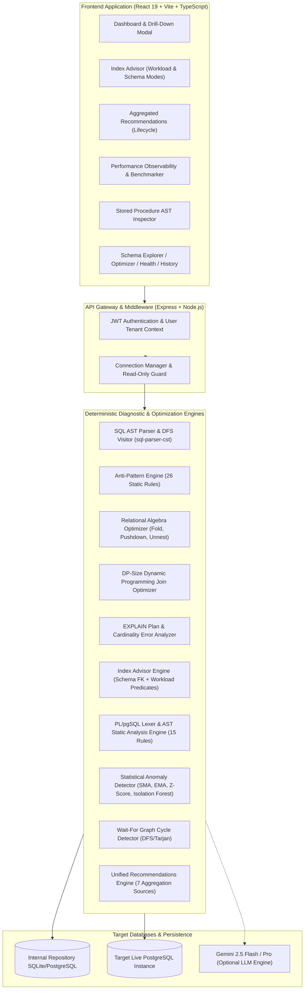

# SQLSense AI — Comprehensive Module Guide & Technical Architecture

> **Target Platform:** SQLSense AI Enterprise Database Intelligence Platform  
> **Repository:** [https://github.com/tnsurya7/sql_health](https://github.com/tnsurya7/sql_health)  
> **Authors:** Senior Database Engineering & Core Quality Assurance Team  
> **Version:** 2.0.0 (Production Release)

---

## Table of Contents
1. [Platform Overview & Foundational Principles](#1-platform-overview--foundational-principles)
2. [Diagnostic Taxonomy: Actuals vs. Estimates vs. Static Analysis vs. AI](#2-diagnostic-taxonomy-actuals-vs-estimates-vs-static-analysis-vs-ai)
3. [System Architecture & Data Flow](#3-system-architecture--data-flow)
4. [Module 1: Dashboard & Live Finding Drill-Down](#module-1-dashboard--live-finding-drill-down)
5. [Module 2: Databases & Connection Manager](#module-2-databases--connection-manager)
6. [Module 3: SQL Analyzer & Static Rule Engine](#module-3-sql-analyzer--static-rule-engine)
7. [Module 4: Query Optimizer & Relational Algebra Engine](#module-4-query-optimizer--relational-algebra-engine)
8. [Module 5: Execution Plans & Telemetry Visualizer](#module-5-execution-plans--telemetry-visualizer)
9. [Module 6: Schema Explorer & Relationship Graph](#module-6-schema-explorer--relationship-graph)
10. [Module 7: Index Advisor (Workload & Schema Inspection)](#module-7-index-advisor-workload--schema-inspection)
11. [Module 8: Stored Procedures (SonarQube-Style PL/pgSQL AST Analyzer)](#module-8-stored-procedures-sonarqube-style-plpgsql-ast-analyzer)
12. [Module 9: Views Quality Inspector](#module-9-views-quality-inspector)
13. [Module 10: Functions Analyzer](#module-10-functions-analyzer)
14. [Module 11: Triggers Static & Side-Effect Inspector](#module-11-triggers-static--side-effect-inspector)
15. [Module 12: Performance Observability, Benchmarking & Anomaly Telemetry](#module-12-performance-observability-benchmarking--anomaly-telemetry)
16. [Module 13: Deadlocks Detector & Wait-For Cycle Graph](#module-13-deadlocks-detector--wait-for-cycle-graph)
17. [Module 14: Optimization Recommendations Aggregator & Lifecycle](#module-14-optimization-recommendations-aggregator--lifecycle)
18. [Module 15: Database Health Evaluator](#module-15-database-health-evaluator)
19. [Module 16: Query History & Performance Registry](#module-16-query-history--performance-registry)
20. [Module 17: RAG Knowledge Base](#module-17-rag-knowledge-base)
21. [Module 18: Settings & Engine Configuration](#module-18-settings--engine-configuration)
22. [Module 19: Authentication, Authorization & Security Protections](#module-19-authentication-authorization--security-protections)
23. [Automated Testing, Verification & Production Build Guidelines](#23-automated-testing-verification--production-build-guidelines)

---

## 1. Platform Overview & Foundational Principles

SQLSense AI is an enterprise-grade database intelligence platform engineered to eliminate database performance degradation, unsafe queries, missing indexes, and procedural code quality bugs. 

Unlike conventional tools that rely on simulated metrics, black-box AI hallucinations, or intrusive query rewriting, SQLSense AI operates on **strict mathematical and deterministic engineering principles**:
* **Explainable Recommendations:** Every optimization candidate or index recommendation links directly to concrete evidence (predicates, plan nodes, execution times, or schema catalog relationships).
* **Strict Read-Only Guard:** Benchmarking and query analysis adhere to non-destructive `SELECT` workloads. Destructive SQL (`UPDATE`, `DELETE`, `DROP`, `TRUNCATE`) without safety guards is actively flagged or prevented.
* **Explicit User Authorization:** No structural schema change (`CREATE INDEX CONCURRENTLY` or table alterations) is ever applied automatically without user review and confirmation.
* **Deterministic Relational Algebra & AST Analysis:** Query transformations (predicate pushdown, constant folding, subquery unnesting, DP-Size join ordering) and stored procedure analyses (PL/pgSQL lexical tokenization, AST visitor, cyclomatic complexity) are computed deterministically.

---

## 2. Diagnostic Taxonomy: Actuals vs. Estimates vs. Static Analysis vs. AI

To ensure complete transparency and prevent confusing theoretical estimates with empirical reality, SQLSense AI categorizes all telemetry into four distinct tiers:

| Tier | Category | Mechanism | Source of Truth | Example Output |
| :--- | :--- | :--- | :--- | :--- |
| **1** | **Empirical Measurements** | High-precision timing via Node.js `process.hrtime.bigint()` & PostgreSQL native engine runtime. | Actual database execution. | `4.21 ms` runtime, `320 KB` shared buffer hits. |
| **2** | **Optimizer Cost Estimates** | Cost units ($C$) produced by the database query planner (e.g. `pg_catalog`, `EXPLAIN`). | Cost model based on disk pages & CPU tuples ($1.0 \times \text{seq\_page\_cost} + 0.01 \times \text{cpu\_tuple\_cost}$). | `cost=1045.20..2450.00`, estimated rows: `10,000`. |
| **3** | **Deterministic Static Analysis** | Lexical tokenization, Abstract Syntax Trees (AST), and graph cycle algorithms (Tarjan/DFS). | Code syntax without executing queries against production data. | Flagging `SP001: Unused Variable`, `R017: DELETE without WHERE`. |
| **4** | **AI-Assisted Diagnostics** | Google Gemini Generative AI (when API keys are explicitly configured). | Large Language Models contextualized with RAG database documentation. | High-level refactoring advice, semantic query intent explanations. |

---

## 3. System Architecture & Data Flow



---

## Module 1: Dashboard & Live Finding Drill-Down

### Purpose & Problem Solved
Provides an instantaneous executive and engineering overview of database health, query execution trends, severity distributions, routine quality, and critical bottlenecks. Previously, KPI counters were static aggregates without transparent drill-downs. The updated Dashboard allows users to click any KPI counter to inspect actual underlying records, rule codes, queries, and root-cause explanations.

### Key Features
* **Clickable Metric Counters:**
  * **Slow Queries:** Opens measured execution times, SQL snippets, and timestamps.
  * **Critical Issues:** Displays security violations, destructive operations, and critical plan flaws.
  * **High Issues:** Displays performance hazards (Cartesian products, full table sequential scans, missing indexes).
  * **Index Recs:** Drills into generated index candidates with immediate links to Index Advisor.
  * **Tables Count:** Direct navigation to Schema Explorer.
* **Granular Drill-Down Modal:**
  * Live vs. Historical badges.
  * Filtering by severity (`CRITICAL`, `HIGH`, `MEDIUM`, `LOW`) and multi-field keyword search (rule code, object name, query text).
  * Honest evidence transparency: clearly explains when finding is schema-level rather than associated with a standalone query.
* **SonarQube-Style Stored Procedure Quality Section:**
  * Batch scans database routine definitions.
  * Displays metrics: Procedures Analyzed, Clean Routines, Requiring Review, Total Findings.
  * Visual severity breakdown bar and Top Highest-Risk routines list.
* **Weighted Database Health Gauge:** Visual circular indicators for Overall, Performance, Security, Indexing, and Quality.

### Backend APIs & Models
* `GET /api/dashboard?connectionId=...`: Returns aggregate KPIs, health scores, charts, and routine quality summaries.
* `GET /api/dashboard/drilldown?type=critical|high|slow_queries|index_recs|tables&connectionId=...`: Returns granular finding records.

---

## Module 2: Databases & Connection Manager

### Purpose & Problem Solved
Manages physical connections to PostgreSQL and SQLite instances. Enforces security isolation, credential encryption, pool sizing, and active database switching.

### Key Features
* Secure multi-connection pool management using `pg.Pool`.
* Read-only mode enforcement (`readOnly: true` prevents executing modifying DDL/DML).
* Real-time connection testing (`SELECT 1` ping verification).
* Catalog introspection fallback: Queries `pg_proc`, `pg_catalog`, and `information_schema`.

### Backend Implementation
* File: `backend/src/database/connection-manager.ts` & `backend/src/database/postgres.adapter.ts`.
* Route: `/api/databases` (CRUD endpoints).

---

## Module 3: SQL Analyzer & Static Rule Engine

### Purpose & Problem Solved
Performs deep static analysis on individual SQL queries without executing them, identifying syntax antipatterns, security vulnerabilities, and performance traps.

### How It Works Internally
1. **Lexical & CST Parsing:** Parses query text using concrete syntax trees (`sql-parser-cst`).
2. **DFS Visitor Traversal:** Traverses nodes to extract table names, column references, projection items, join clauses, and subqueries.
3. **26 Deterministic Antipattern Rules:**
   * `R001`: Wildcard `SELECT *` projection.
   * `R002`: Non-sargable functions on indexed columns (`LOWER(col) = 'val'`).
   * `R005`: Cartesian joins (missing `ON` clause).
   * `R006`: Deeply nested subqueries (depth > 2).
   * `R016`: `UPDATE` without `WHERE` (Critical).
   * `R017`: `DELETE` without `WHERE` (Critical).
   * `R018`: `TRUNCATE` detection.
   * `R025`: Leading wildcard in `LIKE '%...'`.

### Manual Testing Example
```sql
SELECT * FROM customers c, orders o WHERE LOWER(c.email) = 'test@example.com';
```
*Expected Output:* Flags `R001` (SELECT *), `R002` (Non-sargable function), and `R005` (Cartesian cross join).

---

## Module 4: Query Optimizer & Relational Algebra Engine

### Purpose & Problem Solved
Transforms inefficient SQL queries into optimized semantic equivalents using deterministic relational algebra rules and Dynamic Programming join reordering.

### Optimization Techniques
1. **Relational Algebra Simplification:**
   * **Constant Folding:** Simplifies arithmetic and static expressions (e.g. `100 * 24` $\to$ `2400`).
   * **Predicate Pushdown:** Moves filter predicates into derived table subqueries to reduce row volume prior to joining.
   * **Subquery Unnesting:** Converts `WHERE col IN (SELECT ...)` into equi-joins.
   * **Tautology Elimination:** Removes redundant clauses such as `WHERE 1=1 AND status = 'ACTIVE'`.
2. **DP-Size Dynamic Programming Join Order Optimization:**
   * Computes join permutations across relations using intermediate size heuristics.
   * Selects minimum-cost join orders avoiding cross products.
3. **Candidate Validation Pipeline:** Every generated SQL candidate undergoes 5-stage verification (Syntax check, Safety check, Semantic equivalence, Schema column check, and `EXPLAIN` cost evaluation).

---

## Module 5: Execution Plans & Telemetry Visualizer

### Purpose & Problem Solved
Introspects and visualizes physical PostgreSQL query execution plans (`EXPLAIN (ANALYZE, BUFFERS, FORMAT JSON)`). Identifies disparities between estimated cardinality and actual row counts.

### Key Features
* Visual Tree Graph of plan nodes (Seq Scan, Index Scan, Hash Join, Nested Loop, Sort, Aggregate).
* Cardinality Discrepancy Detection: Flags nodes where `actual_rows / estimated_rows > 10.0` or `< 0.1`, alerting the user to outdated database statistics requiring `ANALYZE`.
* Shared Buffer I/O breakdown (Cache hits vs. Disk reads).

---

## Module 6: Schema Explorer & Relationship Graph

### Purpose & Problem Solved
Provides full structural transparency into database schemas: tables, column datatypes, primary keys, foreign key constraints, indexes, views, and routine counts.

### Key Features
* Complete entity-relationship graph visualization using `reactflow`.
* Shortest Join Path calculation: Uses Breadth-First Search (BFS) on the schema foreign key graph to determine the optimal join path between two unrelated tables.
* Detailed metadata drawer: Table size in bytes, row counts, and indexing status.

---

## Module 7: Index Advisor (Workload & Schema Inspection)

### Purpose & Problem Solved
Addresses the issue where tables lacking indexes were not receiving recommendations. PostgreSQL automatically creates indexes for Primary Keys and Unique constraints, but **does not automatically index foreign keys**, leading to sequential table scans during joins and cascade operations.

### Two Complementary Modes
1. **Schema Inspection Mode (Unindexed Foreign Keys):**
   * Introspects table foreign key definitions from `pg_constraint`.
   * Cross-checks existing indexes in `pg_index`.
   * Recommends `CREATE INDEX CONCURRENTLY` for any unindexed foreign key column even if query history is empty.
2. **Workload Query Analysis Mode:**
   * Analyzes executed queries for equality predicates (`=`), range predicates (`<`, `>`, `BETWEEN`), `JOIN` columns, `ORDER BY`, and `GROUP BY`.
   * Synthesizes composite indexes respecting column ordering rules: **Equality columns $\to$ Join columns $\to$ Range columns $\to$ Sort columns**.
   * Evaluates table selectivity, write overhead (Low/Med/High), and storage cost.
   * Deduplicates against existing indexes to prevent redundant index bloat.
3. **Safe Execution Flow:**
   * Any index creation requires explicit user confirmation in a dedicated Authorization Modal.
   * Uses non-blocking `CREATE INDEX CONCURRENTLY` to avoid table locking.

---

## Module 8: Stored Procedures (SonarQube-Style PL/pgSQL AST Analyzer)

### Purpose & Problem Solved
Provides static code analysis for PostgreSQL stored procedures and routines, inspecting code quality, maintainability, and safety without executing procedures against production data.

### 15 Implemented Static Rules
| Rule ID | Rule Title | Category | Severity | Detection Logic |
| :--- | :--- | :--- | :--- | :--- |
| `SP001` | Unused Local Variable | Maintainability | Medium | Declared in `DECLARE` block but never referenced in procedure body. |
| `SP002` | Dead Store Variable | Maintainability | Medium | Assigned via `:=` but value is never subsequently read or returned. |
| `SP003` | Unreachable Code | Reliability | High | Executable statements located after unconditional `RETURN` or `RAISE EXCEPTION`. |
| `SP004` | Redundant Boolean Comparison | Maintainability | Low | Explicit comparison against boolean literal (`= TRUE` or `= FALSE`). |
| `SP005` | Suspicious Tautology | Reliability | High | Constant true predicate such as `1 = 1` in conditional branch. |
| `SP006` | Unsafe Dynamic SQL | Security | Critical | Dynamic string concatenation in `EXECUTE` without parameterized `USING` or `format()`. |
| `SP007` | Swallowed Exception | Reliability | High | `WHEN OTHERS THEN NULL;` block hiding fatal database errors. |
| `SP008` | Transaction in Function | Reliability | Critical | Explicit `COMMIT` or `ROLLBACK` inside a PostgreSQL `FUNCTION` (only allowed in `PROCEDURE`). |
| `SP009` | Unbounded Loop | Reliability | Critical | `LOOP` construct lacking any `EXIT WHEN` termination condition. |
| `SP010` | Invalid NULL Comparison | Reliability | High | Direct equality check `= NULL` instead of `IS NULL`. |
| `SP011` | Redundant Consecutive Assignment | Maintainability | Low | Re-assigning variable immediately without reading previous assignment. |
| `SP012` | Unsafe DML Without WHERE | Security | Critical | `UPDATE` or `DELETE` statement in routine lacking a `WHERE` clause. |
| `SP013` | High Cyclomatic Complexity | Complexity | Medium | Procedure cyclomatic complexity exceeding threshold (> 10 branches/loops). |
| `SP014` | Cursor Resource Leak | Reliability | High | Explicit cursor is `OPEN`ed but never `CLOSE`d before routine exit. |
| `SP015` | Duplicate Branch Condition | Reliability | High | Identical conditional logic repeated across `IF` and `ELSIF` branches. |

### Multi-Dimensional Scoring
Calculates scores from 0 to 100 for Reliability (35%), Security (25%), Maintainability (20%), and Performance (20%).

---

## Modules 9, 10, 11: Views, Functions & Triggers Quality Inspectors

* **Views:** Validates underlying query complexity, presence of `SELECT *` in views (causing fragile column ordinality when base tables alter), and Cartesian joins.
* **Functions:** Enforces volatility classification (`IMMUTABLE`, `STABLE`, `VOLATILE`) and identifies transaction boundary violations.
* **Triggers:** Detects recursive trigger cascades, mutating table hazards, and missing `WHEN` condition guards on row-level triggers.

---

## Module 12: Performance Observability, Benchmarking & Anomaly Telemetry

### Purpose & Problem Solved
Empirical benchmarking and time-series anomaly detection. Fixes the issue where the page would go dark or freeze during benchmark runs by establishing an explicit execution state machine, live progress tracking, and non-blocking asynchronous loops.

### Key Features
* **Execution State Machine:** `IDLE` $\to$ `RUNNING` $\to$ `COMPLETED` / `STOPPED` / `FAILED`.
* **Live Progress & Cancellation:**
  * Animated progress bar and iteration count display.
  * Live elapsed time counter.
  * Non-blocking cancellation via `AbortController`.
  * Safe cleanup on unmount preventing React state leaks.
* **Safe Workload Guard:** Strictly restricts benchmarking to read-only `SELECT` statements.
* **Side-by-Side Before & After Benchmark Comparison:** Executes both original SQL and alternate/optimized SQL under identical database buffer states, reporting empirical latency deltas (ms) and percentage speedup.
* **Anomaly Detection Models:**
  * Simple Moving Average (SMA) & Exponential Moving Average (EMA).
  * Z-Score Spike Detection ($|Z| \ge 2.5$).
  * Change-Point CUSUM Detection.
  * Isolation Forest Multi-Dimensional Anomaly Model (Latency, Rows, Cost).

---

## Module 13: Deadlocks Detector & Wait-For Cycle Graph

### Purpose & Problem Solved
Detects and prevents database concurrency deadlocks by analyzing lock waits and transaction dependency graphs.

### How It Works Internally
1. Queries PostgreSQL lock catalogs (`pg_locks`, `pg_stat_activity`).
2. Constructs a directed Wait-For Graph: Transaction $T_1$ waiting on resource held by $T_2$ creates edge $T_1 \to T_2$.
3. Runs Tarjan's Strongly Connected Components / Depth-First Search cycle detection algorithm.
4. Highlights the cyclic edge causing deadlock and suggests which transaction should be rolled back.

---

## Module 14: Optimization Recommendations Aggregator & Lifecycle

### Purpose & Problem Solved
Solves the issue where the recommendations page was previously empty. Aggregates findings across all 7 diagnostic systems, deduplicating them and providing complete lifecycle management.

### The 7 Diagnostic Ingestion Streams
1. **INDEXING:** Missing index candidates from Index Advisor.
2. **STORED_PROCEDURE:** Code quality findings from SonarQube procedure analyzer.
3. **EXECUTION_PLAN:** Sequential table scans, hash spills, and plan bottlenecks.
4. **SQL_ANALYZER:** Destructive queries, non-sargable functions, wildcard projections.
5. **HEALTH:** Buffer cache hit ratios, transaction wraparound risks.
6. **ANOMALY:** Statistical latency spikes and change points.
7. **OPTIMIZATION:** Relational algebra and join order cost improvements.

### Lifecycle Management
Every recommendation transitions through:
$$\text{OPEN} \longrightarrow \text{ACKNOWLEDGED} \longrightarrow \text{RESOLVED} \quad \text{or} \quad \text{DISMISSED}$$
State changes are persisted in the backend database.

---

## Module 15: Database Health Evaluator

### Purpose & Problem Solved
Calculates a holistic target database health score using deterministic weighted formulas:
$$\text{Overall} = 0.35 \times \text{Perf} + 0.20 \times \text{Security} + 0.20 \times \text{Indexing} + 0.15 \times \text{Quality} + 0.10 \times \text{Config}$$
* Evaluates buffer cache hit ratio (alerting if $< 99\%$).
* Checks connection saturation (`numbackends / max_connections`).
* Checks autovacuum health and transaction ID wraparound risks.

---

## Module 16: Query History & Performance Registry

### Purpose & Problem Solved
Records historical query executions, parameterized fingerprints, execution runtimes, and health scores. Normalizes variable literals into generic templates (e.g., `WHERE id = 42` $\to$ `WHERE id = ?`) to track recurring performance degradation.

---

## Module 17: RAG Knowledge Base

### Purpose & Problem Solved
Maintains an internal vector and keyword repository of PostgreSQL optimization manuals, index manuals, and best practices. Provides grounding context to Gemini LLM prompts to prevent hallucinated suggestions.

---

## Modules 18 & 19: Settings, Security & Authentication

* **JWT Authentication:** Secure user registration, password hashing (`bcrypt`), and token authentication.
* **Read-Only Mode:** Active database toggle ensuring analytical queries cannot accidentally execute DDL or mutating DML.
* **Environment Configuration:** API port, JWT secrets, Gemini API key, and SQLite/PostgreSQL internal storage toggles.

---

## 23. Automated Testing, Verification & Production Build Guidelines

### Test Suite Summary
The repository includes comprehensive automated test suites verifying all core functionality:
* **Backend Test Suite (Jest + ts-jest):** 85 tests covering PL/pgSQL AST parsing, all 15 procedure rules, recommendations aggregation, schema & workload index advisor, and relational algebra algorithms.
  ```bash
  npm test --workspace=backend
  ```
* **Frontend Test Suite (Vitest):** 24 tests covering Zustand store, dashboard drill-down filtering, index advisor modes, benchmark state machine, and recommendation lifecycle.
  ```bash
  npm test --workspace=frontend
  ```
* **Production Build Verification:**
  ```bash
  npm run build
  ```
  Compiles both backend (`tsc`) and frontend (`tsc && vite build`) with zero errors.
